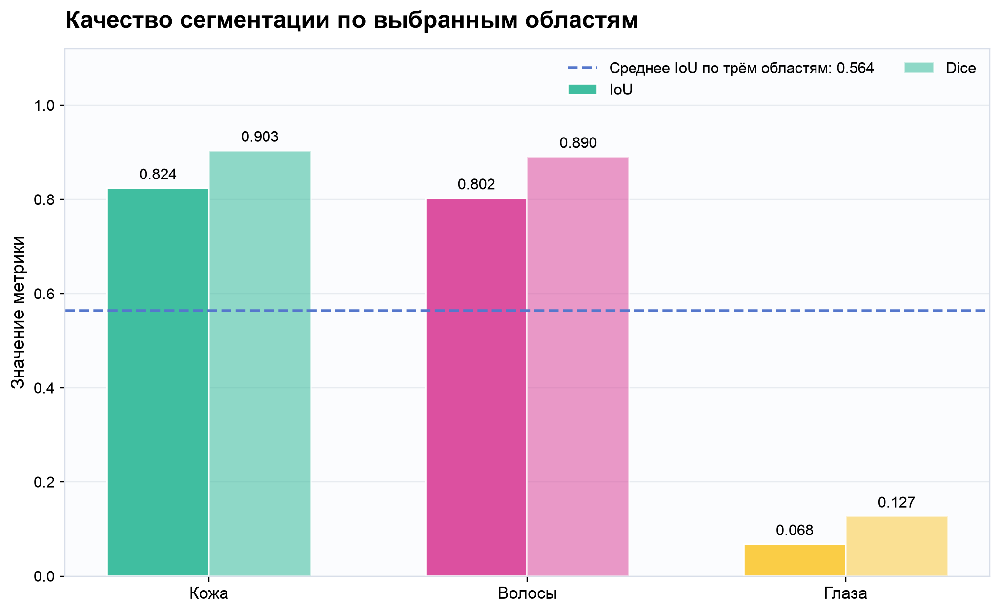
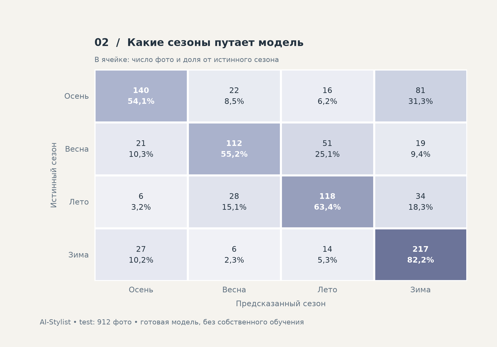

# AI-Stylist — локальный прототип

Локальное приложение Streamlit для анализа фото лица и рекомендаций по одежде на основе введённых мерок. Фото не записывается приложением на диск; модели загружаются отдельно и затем работают локально.

## Описание проекта

AI-Stylist — прототип персонального помощника по подбору стиля для женской аудитории. Приложение анализирует фотографию лица, введённые параметры фигуры и предпочтения, а затем объединяет результаты в индивидуальную стиль-карту с рекомендациями по одежде и причёскам.

В приложении реализованы:

- обнаружение лица и определение его ключевых точек;
- классификация формы лица: овальная, круглая, квадратная, продолговатая или сердцевидная;
- выделение кожи, волос и областей глаз, расчёт медианных цветов;
- определение предполагаемого сезонного цветотипа: весна, лето, осень или зима;
- расчёт условного типа фигуры по обхватам груди, талии и бёдер;
- подбор одежды и причёсок по базе правил с учётом выбранного стиля и длины волос;
- ручная корректировка категорий и формирование стиль-карты.

Архитектура комбинированная: предобученные нейросети анализируют изображения, математические правила обрабатывают мерки, база рекомендаций формирует предложения. Собственное обучение и дообучение моделей не проводились.

```text
Фото → MediaPipe → ViT → форма лица → рекомендации по причёскам
Фото → SegFormer → маски кожи, волос и глаз → медианные цвета
Фото + маски + точки лица → подготовленное изображение → EfficientNetV2-S → цветотип
Мерки → правила → тип фигуры → рекомендации по одежде
Результаты + предпочтения + ручные исправления → стиль-карта
```

Классификатор цветотипа получает изображение с замаскированным фоном, а не медианные RGB. Цветотип отображается в карте; сезонные палитры и зависимость рекомендаций от сезона пока не добавлены. Классы глаз SegFormer обозначают области глаз целиком: их медиану нельзя считать измерением цвета радужки.

## Использованные технологии

| Технология | Назначение |
|---|---|
| Python | Основной язык разработки |
| Streamlit | Веб-интерфейс, загрузка фото, анкета и отображение результатов |
| MediaPipe Tasks | Обнаружение лица и ключевых точек |
| PyTorch | Выполнение нейросетей на CPU без обучения |
| Transformers | Загрузка и запуск ViT и SegFormer |
| timm, torchvision | Архитектура EfficientNetV2-S и преобразования входного изображения |
| Hugging Face Hub | Получение готовых весов и датасета цветотипов |
| Pillow, NumPy | Подготовка изображений, обработка масок и расчёт медиан RGB |
| JSON | База рекомендаций, параметры и отчёты |
| scikit-learn | Метрики классификации цветотипов |
| Matplotlib | Графики результатов и матрица ошибок |
| Docker Compose, Nginx | Подготовленные средства упаковки и развёртывания; статус указан ниже |

## Предобученные модели из открытых репозиториев

| Модель | Архитектура / компонент | Роль |
|---|---|---|
| [MediaPipe Face Landmarker](https://developers.google.com/edge/mediapipe/solutions/vision/face_landmarker) | Готовый комплекс моделей MediaPipe | Обнаружение лица и 478 ключевых точек; проверка одного лица |
| [metadome/face_shape_classification](https://huggingface.co/metadome/face_shape_classification) | Vision Transformer (ViT) | Классификация пяти форм лица |
| [jonathandinu/face-parsing](https://huggingface.co/jonathandinu/face-parsing) | SegFormer, MiT-B5 | Сегментация 19 классов; используются кожа, волосы и области глаз |
| [menes000/armocromia-4-season-effnetv2s](https://huggingface.co/menes000/armocromia-4-season-effnetv2s) | `tf_efficientnetv2_s`, голова 1280→512→4 | Классификация четырёх сезонных цветотипов |

Для сезонной модели используется именно `tf_efficientnetv2_s`, строгая загрузка весов и фиксированный порядок классов `autumn, spring, summer, winter`. Локальные веса повторно используются без обращения к облачному API.

Наличие модуля в приложении не означает измеренное качество: сохранённые количественные оценки есть для SegFormer и сезонного классификатора. Независимая оценка формы лица и полезности рекомендаций пока не представлена.

## Датасеты и их роль

| Датасет | Содержание | Как использован |
|---|---|---|
| [LaPa](https://github.com/jd-opensource/lapa-dataset) | Более 22 тысяч изображений, 11 классов сегментации, 106 ключевых точек | Реальный прогон сегментации на 100 изображениях test; seed=42, список файлов сохранён |
| [menes000/armocromia-12-season](https://huggingface.co/datasets/menes000/armocromia-12-season) | 4 710 подготовленных изображений: 3 798 train и 912 test; 12 сезонных подтипов | Реальная оценка готового классификатора на всех 912 test; подтипы сведены к четырём сезонам. Train использован только для определения самого частого класса базового решения |
| [CelebAMask-HQ](https://github.com/switchablenorms/CelebAMask-HQ) | 30 тысяч изображений, маски 19 классов | Источник обучения готового SegFormer по карточке модели; команда проекта на нём модель не обучала |
| [Deep Armocromia](https://github.com/lorenzo-stacchio/Deep-Armocromia) | Фотографии с сезонными категориями, подготовленными по протоколу с участием экспертов | Часть исходных данных производного набора `menes000/armocromia-12-season`; не отдельный прогон проекта |

LaPa не содержит отдельной разметки радужек или сезонных цветотипов. Отдельный датасет оценки форм лица пока не выбран. LFW не использовался.

Условия использования различаются: LaPa предназначен для некоммерческих применений по лицензии авторов, CelebAMask-HQ — для некоммерческих исследований, сезонная модель и Armocromia — для научного и исследовательского использования. Перед распространением данных и изображений следует учитывать условия исходных источников.

## Запуск

Требуется Python 3.11. На macOS/Linux:

```bash
python3.11 -m venv .venv
source .venv/bin/activate
python -m pip install -r requirements.txt
python scripts/download_models.py
python -m streamlit run app.py --server.address 127.0.0.1
```

Первичная загрузка весов требует интернета. Скрипт загружает MediaPipe Face Landmarker, классификатор формы лица и SegFormer face-parsing в `models/`. Инференс после подготовки выполняется локально. Файл `models/` не включается в Git.

## Сценарий

Загрузите JPEG или PNG до 10 МБ с одним лицом анфас и равномерным освещением. Нажмите «Анализировать фото», затем введите обхваты груди, талии и бёдер в сантиметрах. Выберите стиль и предпочтительную длину причёски, при необходимости исправьте категории вручную и сформируйте карту.

Раздел «Цветовые области» сегментирует весь портрет и показывает маски волос, кожи и глаз с медианными RGB-значениями. Баланс белого, контраст и гистограмма не корректируются, поэтому освещение влияет на цвета. Классы глаз охватывают области глаз целиком, а не радужки. Медианные RGB не определяют цветотип; сезонная нейросеть получает отдельное изображение. Рекомендаций по макияжу и окрашиванию нет.

Модель показывает оценки классов, а не доказанную точность. Классификация фигуры использует эвристические пропорции из источника. Стилистические категории условны, база ограничена; рекомендации не являются правилами для всех людей. Фото зависит от ракурса и освещения. Crop лица расширяется на 20% от границ landmarks — это техническая эвристика.

Источники и пояснения к разметке: [SOURCES.md](SOURCES.md). Текущая проверка моделей и платформы: [MODEL_NOTES.md](MODEL_NOTES.md).

## Сезонный цветотип (исследовательская интеграция)

Добавлена модель [menes000/armocromia-4-season-effnetv2s](https://huggingface.co/menes000/armocromia-4-season-effnetv2s): `tf_efficientnetv2_s` с головой 1280→512→4. Обучения нет. Порядок классов фиксирован: autumn→Осень, spring→Весна, summer→Лето, winter→Зима. Веса загружаются строго, без ImageNet-загрузки; фактический commit сохраняется в `models/seasonal/metadata.json`.

```bash
python -m pip install -r requirements.txt
python scripts/download_models.py --seasonal-only
python scripts/evaluate_seasonal.py --download
# Повторная оценка использует только локальные файлы:
HF_HUB_OFFLINE=1 python scripts/evaluate_seasonal.py
HF_HUB_OFFLINE=1 TRANSFORMERS_OFFLINE=1 python -m streamlit run app.py
```

Датасет сохраняется в `datasets/armocromia-12-season`, его SHA — в `dataset_revision.json`. Для фиксации конкретного снимка используйте `--download --revision <commit>`. Ожидаются ImageFolder `train/<subtype>/*.png` и `test/<subtype>/*.png`. Скрипт проверяет фактическое число test (ожидается 912), переводит имя подтипа в сезон, определяет базовый класс по train. Перед полной оценкой три готовых изображения проходят smoke-проверку выхода. Повторная сегментация готовых изображений не выполняется. Результаты: `evaluation/seasonal/{metrics.json,predictions.csv,confusion_matrix.png,report.md}`. После успешной оценки точные версии записываются в `requirements-validated.txt` рядом с результатами; до успешного запуска версии новых зависимостей не зафиксированы.

Обработка фото: проверка одного лица существующим MediaPipe → квадрат лица → чёрная маска существующего SegFormer → Resize 224×224 bilinear → ToTensor → Normalize ([0.485,0.456,0.406], [0.229,0.224,0.225]) → EfficientNetV2-S → один softmax → ручная корректировка → стиль-карта. Медианные RGB остаются отдельным результатом и не поступают в нейросеть. Фактический вход до нормализации показан в раскрывающемся блоке. Выбор сезона не запускает инференс повторно; смена или удаление фото сбрасывает результаты и ручной выбор.

**Статус проверки:** зависимости, веса и датасет загружены; оценка на 912 подготовленных изображениях завершена. Численные результаты обоих сохранённых прогонов приведены в конце README. Качество подготовки обычных пользовательских фото отдельно не подтверждено.

Точная обработка автора не восстановлена. Карточки описывают маску и чёрный фон, но не её границы. Просмотрены подготовленные образцы всех 12 подтипов: сохраняются лицо с глазами и губами, волосы и видимые уши, фон и шея удалены. Точный алгоритм маски и границ crop неизвестен. Предварительная аппроксимация `SeasonalPreprocessing` в `stylist/seasonal_preprocessing.py` сохраняет кожу, нос, брови, глаза/очки, уши, рот, губы и волосы; исключает шею, одежду и фон. Квадрат имеет сторону 1.6 максимального размера landmarks, центр смещён вверх на 0.12 высоты лица. Все параметры вынесены в dataclass. Фото и маска используют один crop; бинарная маска масштабируется только nearest, фон повторно обнуляется. Эти настройки нужно сверить с образцами автора до выводов о качестве на обычных фотографиях. Точность автора на пользовательских фото не обещается. Сезонных палитр и новых рекомендаций не добавлено.

Оценка готового классификатора на предоставленной автором тестовой части. Собственного обучения не проводилось. Автор восстанавливал порядок классов по оценочной выборке: это воспроизведение опубликованного эксперимента, а не новая полностью независимая проверка. Его показатель «правильно распознанные объекты сезона / все объекты сезона» — recall. Число из карточки само по себе не является нашим измерением; совпавшее значение в сохранённом прогоне подтверждено локальными отчётами. Превосходство над работами на других разбиениях не заявляется. Модель и датасет разрешены для научных и исследовательских целей, без коммерческого использования.

### Графики для презентации

```bash
python scripts/plot_seasonal.py
```

Скрипт сверяет `predictions.csv` с `metrics.json` и строит общий лист, сравнение с базовым решением, матрицу ошибок (числа и доли по строкам), precision/recall/F1 сезонов и распределение классов. Пять графиков в PNG, SVG и PDF сохраняются в `evaluation/seasonal/figures/`. Модель повторно не запускается.

Область внутри внешнего контура губ MediaPipe дополнительно включается в сезонную маску (`preserve_mouth_landmarks=True`), чтобы ошибка SegFormer не вырезала рот. Сохраняются исходные RGB, цвет не дорисовывается. Это изменение касается только обычных фотографий; готовые изображения test и их оценка не меняются. После обновления нажмите «Начать анализ» повторно, чтобы заменить сохранённый в сессии вход.

## Docker (CPU)

Конфигурация добавлена, но сборка Linux-образа в среде разработки не проверена: доступ к Docker socket запрещён. `requirements-docker.txt` фиксирует прямые зависимости по локально установленным версиям; доступность соответствующих Linux wheels проверится при сборке. PyTorch устанавливается из CPU-индекса, без CUDA.

Нужны Docker с Compose и уже подготовленная папка `models/` рядом с `compose.yaml`. Веса подключаются только для чтения; токен Hugging Face для запуска не нужен. Датасет и результаты оценки в образ не входят.

```bash
docker compose up --build -d
docker compose logs -f
```

Открыть http://localhost:8501. В Compose указан `linux/amd64`; на Apple Silicon используется эмуляция, поэтому анализ может работать медленнее нативного Python.

```bash
# Остановка:
docker compose down
# Размер образа после сборки:
docker image inspect ai-stylist:local --format '{{.Size}}'
# Размер подключаемых весов:
du -sh models
```

Оценочный размер распакованного CPU-образа — 2–4 ГБ, точное число зависит от Linux wheels и определяется после сборки. Текущая папка весов занимает около 1,1 ГБ, включая два формата весов SegFormer. Она хранится отдельно от образа. Контейнер использует эти же файлы, не создавая дополнительную копию. Размер образа — место на диске, не требуемая оперативная память.

При переносе на другой компьютер скопируйте проект и `models/`, затем соберите образ. Сборка требует сети для базового образа и пакетов, запуск и анализ используют локальные модели. Если нужен единый переносимый образ с весами внутри, потребуется другая сборка с включением `models/`; она будет примерно на размер весов больше.

### Перенос на x64-сервер под существующий Nginx

Подготовлен комплект для **https://nai1ka.ru/stylist/**:

```bash
bash scripts/package_deployment.sh
```

Готовый каталог `release/stylist/` содержит образ, архив весов, серверный Compose и фрагмент Nginx. Полная инструкция: [deploy/README.md](deploy/README.md). Сервер использует загруженный образ без сборки; Streamlit настроен на префикс `/stylist`, WebSocket проксируется существующим Nginx. Сборка здесь не проверена из-за недоступности Docker socket.

## Результаты прогонов

Ниже приведены фактические значения из сохранённых отчётов проекта, а не только опубликованные показатели авторов. При подготовке этого README модели повторно не запускались. Обучение и дообучение в обоих экспериментах не проводились.

### Сегментация кожи, волос и областей глаз

- Модель: `jonathandinu/face-parsing`.
- Ревизия: `8ee285cb01328e6b6d0d33f2cdbc6d8505ac069d`.
- Датасет: LaPa, test; выбрано и обработано 100 изображений, seed=42.
- Устройство: CPU; вход processor — 512×512.
- IoU и Dice рассчитаны по суммарным TP/FP/FN всей выборки отдельно для каждой области. Глаза объединены в одну область; `skin` сопоставлен только с `skin`, без добавления носа, ушей и шеи.

| Область | IoU | Dice / F1 |
|---|---:|---:|
| Кожа | 0,8235 | 0,9032 |
| Волосы | 0,8022 | 0,8902 |
| Области глаз | 0,0676 | 0,1266 |

**Среднее IoU по трём выбранным областям: 0,5644.** Это не среднее по всем 19 классам модели.

| Время | Значение |
|---|---:|
| Среднее | 3,5596 с |
| Медиана | 3,3555 с |
| p95 | 4,5043 с |

Время измерено после одного прогревочного прохода: подготовка RGB-входа, processor, инференс, изменение размера logits и получение карты классов; чтение файлов и запись отчётов исключены. Это время сегментации, не всего приложения.

Кожа и волосы имеют заметно более высокое совпадение с эталоном, чем глаза. Низкий IoU глаз означает, что этот компонент пока требует проверки и улучшения; по данному прогону нельзя заявлять надёжное выделение радужки или определение её цвета. На результат также влияют различия схем разметки LaPa и исходного датасета модели. Истинная точность цвета здесь не измерялась.



Артефакты: [полный отчёт](evaluation/results/summary.md), [метрики JSON](evaluation/results/metrics.json), [результаты по изображениям](evaluation/results/per_image.csv), [список выборки](evaluation/lapa_test_100_seed42.json).

### Определение четырёх сезонных цветотипов

- Модель: `menes000/armocromia-4-season-effnetv2s`.
- Ревизия модели: `3bd51f4ce124cd91190f9ecdbd74ff950456a8f8`.
- Датасет: `menes000/armocromia-12-season`, ревизия `a65d0615b24c0d4ba1e8df446f7adcc653a4e501`.
- Выборка: все 912 изображений test. 12 подтипов объединены в четыре сезона по префиксу имени.
- CPU, режим eval, вход RGB 224×224, нормализация ImageNet; повторная сегментация и аугментации не применялись.

| Показатель | Результат |
|---|---:|
| Accuracy | **64,36%** |
| Macro-F1 | **63,51%** |
| Базовое решение: всегда «Осень» | 28,40% |
| Преимущество над этим базовым решением | 35,96 процентного пункта |

Базовый класс определён по train (3 798 изображений), а его accuracy рассчитана на test. Поэтому значение базового решения может отличаться от приведённого в карточке модели.

| Сезон | Изображений | Precision | Recall | F1 |
|---|---:|---:|---:|---:|
| Осень | 259 | 72,16% | 54,05% | 61,81% |
| Весна | 203 | 66,67% | 55,17% | 60,38% |
| Лето | 186 | 59,30% | 63,44% | 61,30% |
| Зима | 264 | 61,82% | 82,20% | 70,57% |

Матрица ошибок: строки — правильный сезон, столбцы — предсказание.

| Правильный / предсказанный | Осень | Весна | Лето | Зима |
|---|---:|---:|---:|---:|
| Осень | 140 | 22 | 16 | 81 |
| Весна | 21 | 112 | 51 | 19 |
| Лето | 6 | 28 | 118 | 34 |
| Зима | 27 | 6 | 14 | 217 |

Модель предсказала «Зиму» 351 раз при 264 эталонных примерах этого сезона. Высокий recall зимы сочетается с ложными отнесениями к ней других сезонов; один recall не означает высокую точность всех предсказаний «Зима».



Артефакты: [полный отчёт](evaluation/seasonal/report.md), [метрики JSON](evaluation/seasonal/metrics.json), [предсказания CSV](evaluation/seasonal/predictions.csv), [общий лист графиков](evaluation/seasonal/figures/seasonal_overview.png). Дополнительные графики в PNG/SVG/PDF находятся в [evaluation/seasonal/figures](evaluation/seasonal/figures/).

Этот прогон воспроизводит оценку на подготовленных изображениях автора. Он не проверяет качество сегментации и обрезки обычного пользовательского фото. Автор использовал оценочную выборку для восстановления порядка классов; результат не является новой полностью независимой оценкой. Accuracy и F1 измеряют совпадение с условными метками датасета, а не объективную правильность стилистической категории.

### Что пока не оценено количественно

- Качество классификации формы лица на отдельной размеченной выборке.
- Согласие расчёта типа фигуры с независимой оценкой специалиста.
- Полезность рекомендаций и преимущество персонального подбора для пользователей.
- Ошибка извлечения цвета относительно эталонной маски и устойчивость к освещению.
- Качество определения цветотипа на обычных фото после всей обработки приложения.
- Полное время получения стиль-карты и доля успешных пользовательских сценариев.

Для этих компонентов проценты качества не заявляются.
