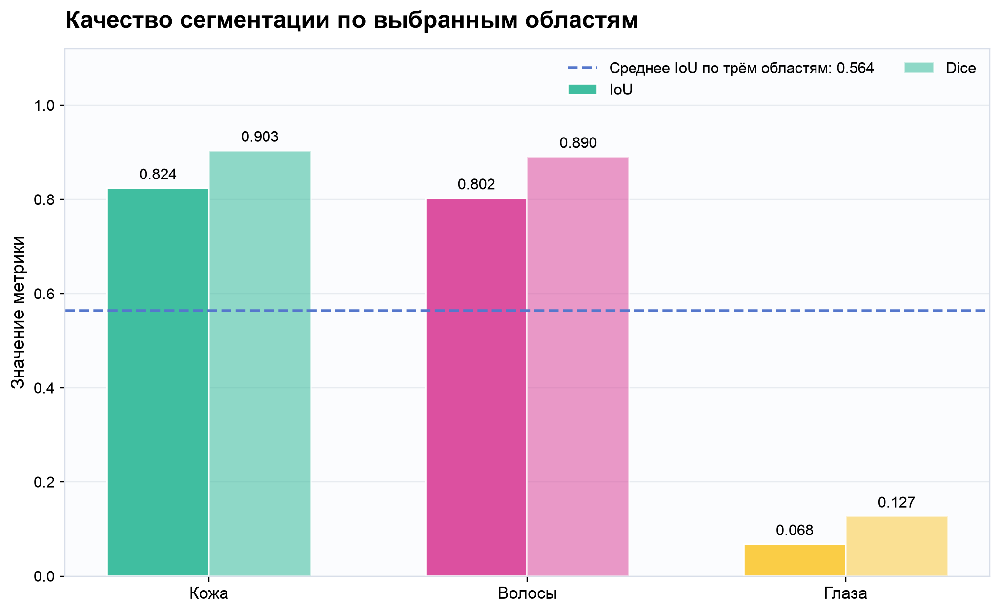
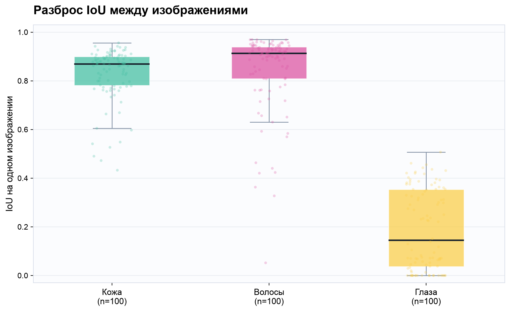
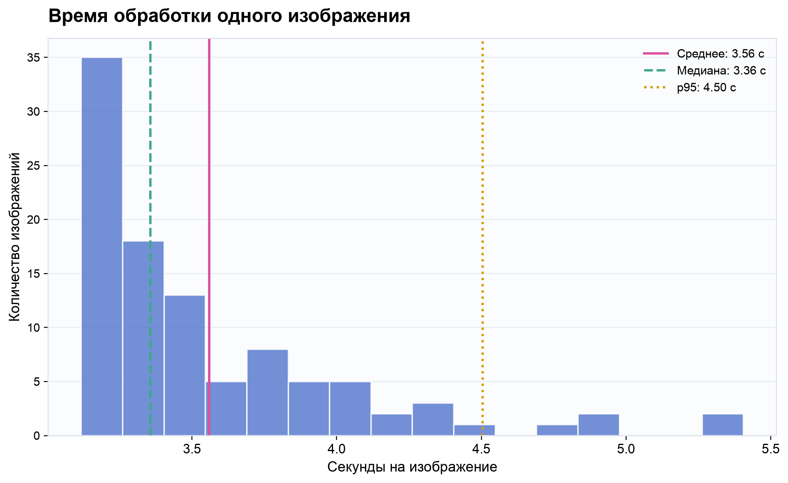

# Оценка сегментации LaPa

Модель: jonathandinu/face-parsing (ревизия `8ee285cb01328e6b6d0d33f2cdbc6d8505ac069d`)
Датасет: LaPa, test
Выборка: 100 изображений, seed=42
Обучение и дообучение не проводились.

| Область | IoU | Dice |
|---|---:|---:|
| Кожа | 0.8235 | 0.9032 |
| Волосы | 0.8022 | 0.8902 |
| Глаза | 0.0676 | 0.1266 |

Среднее IoU по трём выбранным областям: 0.5644
Среднее время сегментации: 3.5596 с (медиана 3.3555 с, p95 4.5043 с)
Устройство: cpu
Загрузка весов: 0.356 с
Размер входа processor: SizeDict(height=512, width=512, longest_edge=None, shortest_edge=None, max_height=None, max_width=None, min_pixels=None, max_pixels=None)

Полное изображение обработано через тот же `segment_face` и `AutoImageProcessor`, что использует приложение. Метрики рассчитаны по суммарным TP/FP/FN на всех 100 изображениях. LaPa skin сопоставлен только с skin модели; уши, нос и шея к коже не добавлялись. Глаза — объединение левого и правого глаза.

## Ограничения

- Небольшая выборка: 100 изображений.
- Схемы разметки LaPa и CelebAMask-HQ различаются; использовано указанное сопоставление областей.
- Радужки и точность определения цвета не оценивались.
- Проверка на другом датасете сама по себе не доказывает отсутствие пересечений изображений с обучением модели.

Иллюстрации `fixed_001` и `fixed_002` соответствуют первым двум позициям сохранённого manifest. Третий пример — минимальное среднее IoU по доступным областям среди этих 100 изображений. Перед публичным использованием фотографий проверьте условия датасета: [официальная страница LaPa](https://github.com/jd-opensource/lapa-dataset).

## Графики

### Сравнение суммарных IoU и Dice по областям

### Распределение IoU по отдельным изображениям

### Распределение времени сегментации

